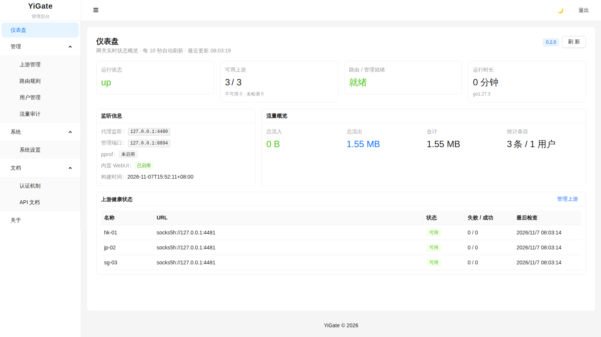
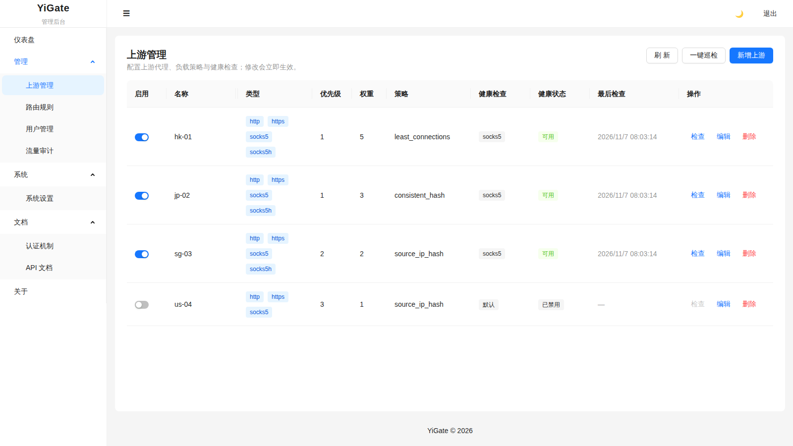
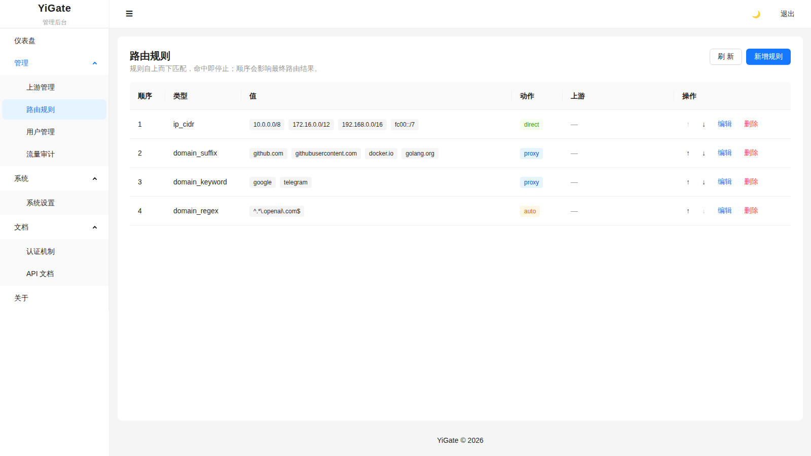
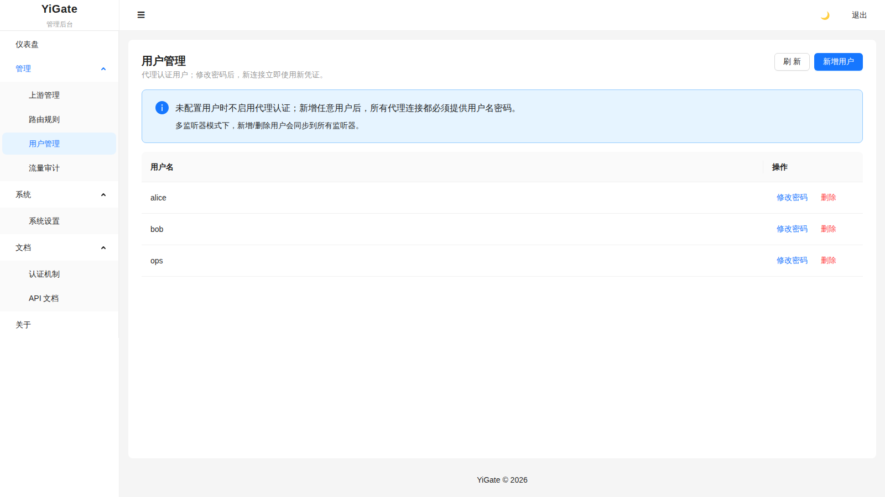
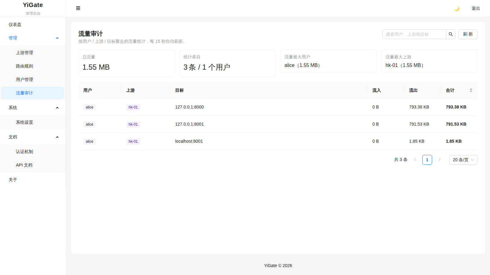
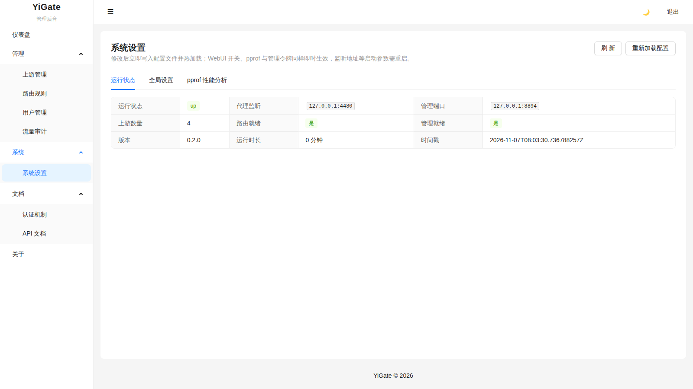

# YiGate

[简体中文](README.md) · [English](README.en.md)

A lightweight unified proxy gateway. It multiplexes **HTTP, HTTPS CONNECT and SOCKS5 on a single port** and adds rule-based routing, multiple upstreams, health checks, socks5h remote resolution, hot configuration reload and a built-in admin UI, so the proxy stays operable in production.

> Compliant, lightweight, operable. Obfuscation and non-compliant protocols are explicitly unsupported.

> **Repository notice**
>
> - **Primary repository (the only development and release channel)**: <https://cnb.cool/yi.team/yigate>
> - **GitHub mirror**: <https://github.com/ococl/yigate>
>
> GitHub is a mirror only. Code, tags and Releases (including all attached artifacts) are pushed by the
> CNB pipeline after an official release. The mirror **runs no CI** and is never a release source.
> Please file issues, pull requests and discussions in the primary repository.
> See [VERSIONING.md](VERSIONING.md) for the release process and [CONTRIBUTING.md](CONTRIBUTING.md) for contributing.

---

## Features

- **Multiple protocols on one port**: a single listener detects and dispatches HTTP, HTTPS CONNECT and SOCKS5.
- **Rule-based routing**: `domain` / `domain_suffix` / `domain_keyword` / `domain_regex` / `ip_cidr` (IPv4 + IPv6) / `geosite` / `match`; actions are `direct` (direct only), `proxy` (upstream only), `direct_first`, `proxy_first`, `auto` (follows global `auto.mode`) and `deny`.
- **Multiple upstreams and balancing**: `weighted_round_robin` / `least_connections` / `consistent_hash` / `source_ip_hash`, with priority, weights and dead-node eviction.
- **Health checks**: TCP / HTTP / HTTPS / TLS probes.
- **DNS enhancements**: built-in DoH / DoT resolvers, system DNS fallback, TTL cache, IPv4/IPv6 precedence policies.
- **socks5h remote resolution**: the upstream performs name resolution, avoiding local DNS leaks.
- **Transparent proxying**: Linux only, `redirect` and `tproxy` modes (iptables/nftables examples under `scripts/`).
- **TLS termination**: TLS at the listener level, with optional client certificates (mTLS).
- **Hot reload**: automatic reload on file changes; listen addresses, TLS, upstreams and rules reload without restart, tearing down old listeners before creating new ones.
- **Access control**: CIDR allowlists, per-IP rate limiting, per-user concurrency limits, anonymous toggle.
- **SSRF protection**: `destination_policy` denies loopback / private / link-local / cloud metadata targets by default.
- **Traffic auditing and quotas**: per-user / per-upstream / per-target statistics with quota enforcement; traffic is persisted per calendar day, retained 30 days by default and pruned automatically.
- **Observability**: `/health`, `/metrics` (Prometheus, `yigate_` prefix), `/api/v1/status` and runtime configuration APIs.
- **Embedded web UI**: Vue 3 + antdv-next, shipped inside the binary, no separate deployment; the UI switches between Simplified Chinese and English.
- **Flexible deployment**: native binary, Docker and systemd; the runtime layout is identical for the binary and the container.
- **Cross-platform**: builds for 26 targets (Linux / macOS / Windows / FreeBSD / OpenBSD / NetBSD, including arm/mips/riscv/loong64).

---

## Screenshots

The admin UI is embedded in the binary and served as soon as the service starts (default `http://127.0.0.1:8890`); no separate frontend deployment is needed. Screenshots below are from the `v0.2.0` demo instance with sample data.



| Upstreams | Routing rules |
| --- | --- |
| [](docs/screenshots/upstreams.png) | [](docs/screenshots/rules.png) |
| **Users** | **Traffic audit** |
| [](docs/screenshots/users.png) | [](docs/screenshots/traffic.png) |
| **System settings** | **Sign in** |
| [](docs/screenshots/settings.png) | [](docs/screenshots/login.png) |

---

## Project layout

```text
.
├── src/                  # Go backend (module yigate)
│   ├── main.go           # CLI entry point
│   ├── config.go         # Configuration loading / validation
│   ├── server.go         # Unified TCP server / hot reload
│   ├── config.sample.yml # Sample configuration
│   └── proxy/            # Proxy core (protocols / routing / upstreams / DNS / TPROXY / admin)
├── web/                  # Frontend (Vue 3 + Vite + TS + antdv-next), built separately
├── deploy/               # Docker / systemd / configuration templates
├── scripts/              # Build / release / platform manifest / TPROXY examples
├── docs/screenshots/     # UI screenshots
├── test/e2e/             # Integration and benchmark scripts
├── .cnb.yml              # CNB, the primary release channel
├── .github/workflows/    # GitHub manual debugging entry point (never auto-triggered; builds run on CNB)
├── docker-compose.yml    # One-command local deployment
└── Makefile
```

### Runtime layout (identical for the native binary and Docker)

```text
.
├── data/
│   ├── config.yml        # Runtime configuration (default -config path, generated on first start)
│   ├── traffic.json      # Persisted traffic audit data (auto-generated, 30-day retention by default)
│   ├── geosite.dat       # GeoSite data
│   └── geosite.dat.meta.json  # GeoSite version metadata (auto-generated: SHA-256, source, check time)
└── logs/
    └── yigate.log        # Rotating log
```

---

## Quick start

### Option 1: native binary

```bash
cd src
GOPROXY=https://goproxy.cn,direct go build -o yigate .
./yigate -config data/config.yml run      # data/config.yml is generated on first run
```

Once running in the foreground:

- Proxy endpoint: `http://127.0.0.1:8891` (HTTP/HTTPS/SOCKS5 share the port)
- Admin UI: `http://127.0.0.1:8890`
- Health check: `curl http://127.0.0.1:8890/health`

### Option 2: Docker (recommended)

```bash
docker compose up --build
```

The container mounts `./data` and `./logs` from the current directory; configuration lives at `/var/lib/yigate/data/config.yml`. By default the proxy and admin ports bind to the host loopback only. To expose them on a LAN, set `YIGATE_PROXY_BIND=0.0.0.0` and configure proxy user credentials first so you do not run an open anonymous proxy.

### Option 3: systemd

```bash
sudo bash deploy/systemd/install.sh
sudo systemctl start yigate
```

`install.sh lan` generates a random proxy password and admin token, written to `/etc/yigate/initial-credentials` (readable by root only).

---

## Configuration highlights

See `src/config.sample.yml` for the full example. Key fields:

| Field | Description |
|------|-------------|
| `listen` / `listeners` | Proxy listen addresses; `listeners` allows per-port TLS, users and access control, while top-level `users`/`access_control` act as defaults for ports that do not override them |
| `management` | Dedicated admin port (WebUI + API) |
| `management_auth_token` | When non-empty, every admin endpoint requires a Bearer token; mandatory when bound to a non-loopback address |
| `webui.enabled` | Defaults to true; hot-reloadable, and disabling it leaves only the API on the admin port |
| `enable_pprof` | Defaults to false; enables `/debug/pprof/*` on the admin port (authenticated), hot-reloadable |
| `users` | Empty means anonymous proxying is allowed |
| `tls` | TLS termination (`cert_file` / `key_file` / `client_ca_file`) |
| `upstreams` | Upstream proxies of type `http`/`https`/`socks5`/`socks5h`, with balancing policy and health checks |
| `routing.rules` / `routing.final` | Rule list (first match wins) and fallback action: `direct`/`proxy`/`direct_first`/`proxy_first`/`auto`/`deny` |
| `routing.auto.mode` | `direct_first` (default) or `proxy_first`; per-rule `direct_first`/`proxy_first` overrides this global setting |
| `routing.socks5h_redirect` | Let the upstream resolve target domains (remote DNS); can be scoped with `upstreams` |
| `routing.geosite` | Data path, update URL/interval, `update_token` (pull from upstream), and `sync_enabled`/`sync_token` (read-only downstream sync) |
| `dns` | `system` / `doh` / `dot`; `ip_precedence` controls IPv4/IPv6 preference; `fallback` defaults to true |
| `destination_policy` | `protect_private` (default true), `default_action`, plus domain/port/CIDR allow and deny lists |
| `timeouts` | `dial` / `handshake` / `http_exchange` / `tunnel_idle`; 0 uses built-in defaults |
| `log` | Level, format (json/console), output (stdout/file) and rotation settings |
| `check_interval` | Health check interval in seconds; 0 disables periodic checks |
| `max_connections` | Concurrency cap used when a listener sets none; 0 means unlimited |
| `traffic_audit.enabled` | Traffic auditing and quotas; `retention_days` controls detail retention (30 by default) |
| `tproxy.enabled` | Transparent proxying (Linux only) |

Traffic details are stored in `traffic.json` next to the configuration file (mode 0600) and include usernames and target domains; treat them as sensitive data.

`${ENV_NAME}` references in the configuration are expanded strictly: a missing or empty value aborts startup. Loading validates listen addresses, TLS files, upstream URLs/policies/health checks, access-control numbers and routing enums, so invalid configuration fails fast instead of degrading silently.

---

## Management API

| Path | Description |
|------|-------------|
| `GET /health` | Health status |
| `GET /metrics` | Prometheus metrics (`yigate_` prefix) |
| `GET /api/v1/status` | Runtime summary (version and uptime) |
| `GET /api/v1/version` | Version information |
| `POST /api/v1/reload` | Manually reload the configuration |
| `GET /api/v1/traffic` | Traffic statistics snapshot (`enabled` reports the audit switch) |
| `GET/POST /api/v1/config/upstreams` | List / add upstreams (including health-check settings and the `enabled` switch) |
| `PUT/DELETE /api/v1/config/upstreams/{name}` | Update / delete an upstream (partial update: omitted fields keep their values; `enabled=false` pauses scheduling and health checks) |
| `GET/POST /api/v1/config/rules` | List / append routing rules |
| `PUT /api/v1/config/rules` | Replace all routing rules atomically (single validation, write and hot reload) |
| `POST /api/v1/config/rules/batch-toggle` | Bulk enable/disable rules (single write) |
| `PUT /api/v1/config/rules/{index}` | Update a routing rule (including the `disabled` switch) |
| `POST /api/v1/config/rules/{index}/move` | Move a routing rule up / down |
| `DELETE /api/v1/config/rules/{index}` | Delete a routing rule |
| `GET/POST /api/v1/config/users` | List / add users |
| `PUT /api/v1/config/users/{username}` | Change a user's password |
| `DELETE /api/v1/config/users/{username}` | Delete a user |
| `GET/PUT /api/v1/config/settings` | Read / partially update global settings (persist + hot reload) |
| `GET /api/v1/geosite` | GeoSite version, size, source and sync configuration |
| `POST /api/v1/geosite/update` | Update GeoSite data immediately (admin token required) |
| `GET /api/v1/geosite/dat` | Download GeoSite data (supports ETag/304, accepts the read-only sync token) |

Configuration writes are validated first; if the subsequent hot reload fails, the previous file is restored automatically so a broken configuration is never left behind.

### GeoSite updates and downstream sync

The **GeoSite data** page in the web UI shows the version (first 12 characters of the SHA-256), file size, data timestamp, source URL and last check time, and supports manual updates. The data file always lives next to the configuration file as `geosite.dat`, managed by the system; the UI neither needs nor allows a custom path. Updates prefer configured healthy upstreams and fall back to a direct connection when all fail; this can be disabled with `use_upstream`.

For multi-node deployments, one node can update centrally while the others sync read-only. The sync token is generated randomly, masked by default in the web UI and copyable with one click. Enabling **Allow downstream sync** generates a token automatically when empty, and it can be regenerated (or via `GET`/`POST /api/v1/geosite/sync-token`) without editing files by hand:

```yaml
# Upstream node: serves read-only sync (sync_token is generated and written back when enabled)
routing:
  geosite:
    auto_update: true
    update_url: "https://github.com/v2fly/domain-list-community/releases/latest/download/dlc.dat"
    update_interval: 24h
    use_upstream: true
    sync_enabled: true

# Downstream node: syncs from the upstream node
routing:
  geosite:
    auto_update: true
    update_url: "http://node-a:8892/api/v1/geosite/dat"
    update_interval: 24h
    use_upstream: true
    update_token: "<sync token generated by the upstream web UI>"
```

Sync uses conditional requests: the serving node returns `ETag` (content SHA-256) and `X-GeoSite-Version`, the downstream sends `If-None-Match`, and unchanged data returns `304` without rewriting the file or triggering a reload. When content changes, `geosite.dat` is replaced atomically, `geosite.dat.meta.json` is written and the routing table is hot-reloaded; no restart is required.

`/debug/pprof/*` is only enabled when `enable_pprof: true` (a sensitive endpoint; never expose it publicly).

---

## Build and development

```bash
# Go backend
cd src && GOPROXY=https://goproxy.cn,direct go build -o yigate .

# Frontend (separate project, Node 26.13, see .nvmrc)
cd web && npm ci && npm run build
# After building, embed-dist.mjs minifies and embeds the web UI, then rebuild Go
# (`make build` performs both steps automatically)

# Full build / release
make build
./scripts/release.sh 1.2.0
```

Tests:

```bash
# Full Go test suite and race detector
cd src && GOPROXY=https://goproxy.cn,direct go test ./...
cd src && GOPROXY=https://goproxy.cn,direct go test -race ./...

# Frontend unit / API contract tests
make web-test

# Real-browser E2E (install Chromium first)
make web-e2e-install
make web-e2e
```

`release.sh` only runs release gates and builds the web UI. Cross-platform compilation, packaging, SBOM generation and checksums are all produced by `scripts/ci-build.sh`, so CI and official releases never diverge into two artifact pipelines.

---

## Security and compliance

YiGate is intended for lawful, compliant proxying only. The project explicitly **does not support obfuscation protocols, tunnel camouflage or non-compliant transports**, and does not accept feature requests for them. The admin API and pprof are sensitive endpoints and should be protected with tokens and network isolation. See [SECURITY.md](SECURITY.md) for the deployment security baseline; report vulnerabilities through the private disclosure channel rather than public issues.

See also [FEATURES.md](FEATURES.md), [VERSIONING.md](VERSIONING.md), [CONTRIBUTING.md](CONTRIBUTING.md), [SECURITY.md](SECURITY.md) and [CHANGELOG.md](CHANGELOG.md).

## License

See [LICENSE](LICENSE).
