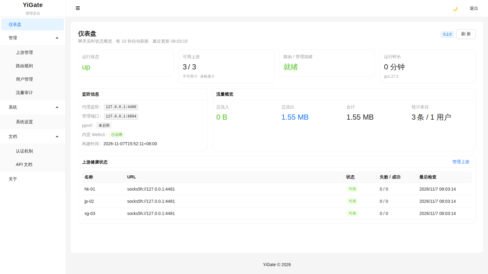
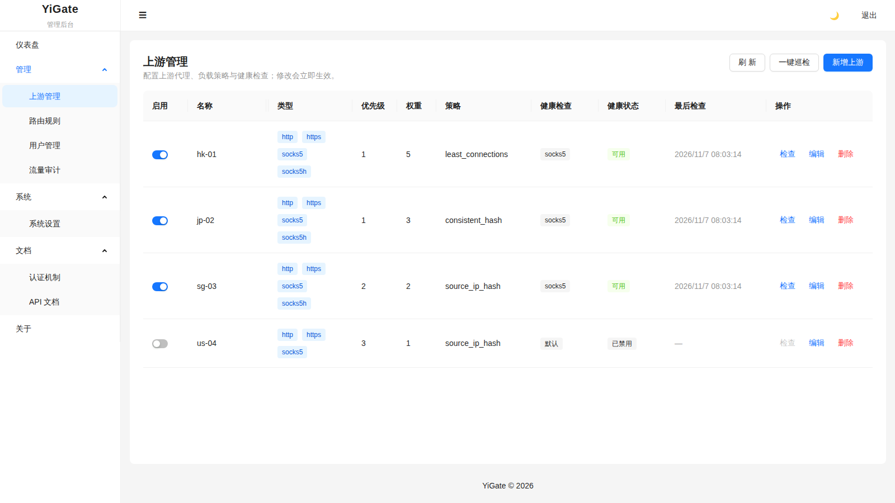
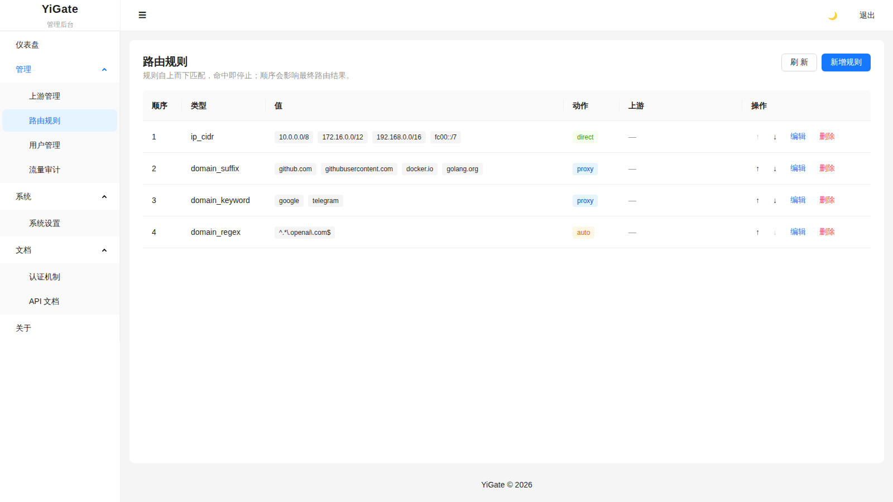
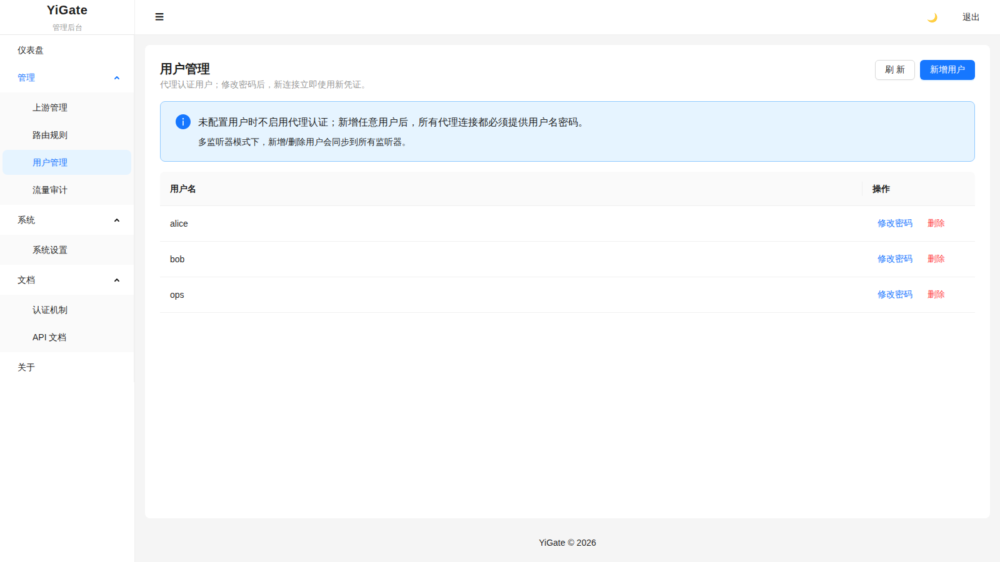
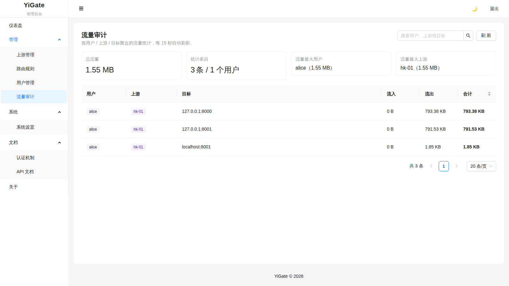
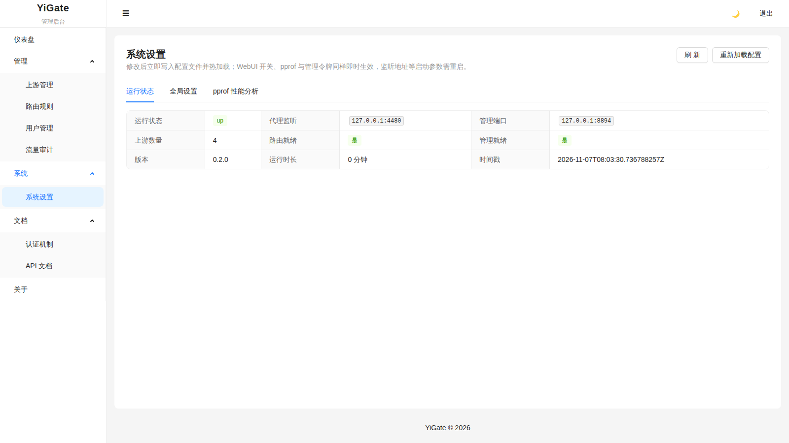

# YiGate

轻量级统一代理网关。让 **HTTP / HTTPS CONNECT / SOCKS5 共用单端口**接入，并通过规则路由、多上游、健康检查、socks5h 远端解析、配置热加载和内置管理界面，提供可运维的代理能力。

> 合规、轻量、可运维。明确不支持任何混淆 / 非合规协议。

---

## 特性

- **单端口多协议**：同一监听端口自动识别并分流 HTTP、HTTPS CONNECT、SOCKS5。
- **规则路由**：`domain` / `domain_suffix` / `domain_keyword` / `domain_regex` / `ip_cidr`（IPv4+IPv6）/ `geosite` / `match`，动作支持 `direct` / `proxy` / `auto`。
- **多上游与负载**：`weighted_round_robin` / `least_connections` / `consistent_hash` / `source_ip_hash`，含优先级、权重、死节点剔除。
- **健康检查**：TCP / HTTP / HTTPS / TLS 四种探测。
- **DNS 增强**：内置 DoH / DoT 解析器，系统 DNS 兜底，TTL 缓存，IPv4/IPv6 优先级策略。
- **socks5h 远端解析**：上游侧完成域名解析，避免本地 DNS 泄露。
- **透明代理**：仅 Linux，支持 `redirect` / `tproxy` 两种模式（`scripts/` 下含 iptables/nftables 示例）。
- **TLS 终止**：listener 层统一 TLS，支持客户端证书（mTLS）。
- **配置热加载**：文件变更自动重载，监听地址 / TLS / 上游 / 规则可热更新，先关旧 listener 再建新。
- **访问控制**：CIDR 白名单、单 IP 限速、用户并发限制、匿名开关。
- **SSRF 防护**：`destination_policy` 默认拒绝回环 / 私网 / 链路本地 / 云元数据等敏感目标。
- **流量审计与配额**：按 user / upstream / target 三维统计，支持配额限制；流量按自然日持久化，默认保留 30 天并自动清理。
- **可观测性**：`/health`、`/metrics`（Prometheus，`yigate_` 前缀）、`/api/v1/status`、运行时配置 API。
- **内嵌 Web 管理界面**：Vue 3 + antdv-next，随二进制启动，无需额外部署。
- **多形态部署**：原生二进制、Docker、systemd 服务；运行目录布局在二进制与 Docker 间一致。
- **跨平台**：26 个目标平台构建（Linux / macOS / Windows / FreeBSD / OpenBSD / NetBSD，含 arm/mips/riscv/loong64 等）。

---

## 界面预览

管理后台由二进制内嵌，随服务启动即可访问（默认 `http://127.0.0.1:8890`），无需单独部署前端。以下截图取自 `v0.2.0` 演示实例，数据均为示例。



| 上游管理 | 路由规则 |
| --- | --- |
| [](docs/screenshots/upstreams.png) | [](docs/screenshots/rules.png) |
| **用户管理** | **流量审计** |
| [](docs/screenshots/users.png) | [](docs/screenshots/traffic.png) |
| **系统设置** | **登录** |
| [](docs/screenshots/settings.png) | [](docs/screenshots/login.png) |

---

## 目录结构

```text
.
├── src/                  # Go 后端（module yigate）
│   ├── main.go           # CLI 入口
│   ├── config.go         # 配置加载 / 校验
│   ├── server.go         # 统一 TCP Server / 热加载
│   ├── config.sample.yml # 配置示例
│   └── proxy/            # 代理核心（协议 / 路由 / 上游 / DNS / TPROXY / 管理）
├── web/                  # 前端（Vue3 + Vite + TS + antdv-next），独立构建
├── deploy/               # Docker / systemd / 配置模板
├── scripts/              # 构建 / 发布 / 平台清单 / TPROXY 示例
├── docs/screenshots/     # 界面截图
├── test/e2e/             # 联调与基准脚本
├── .cnb.yml              # CNB 主发布通道
├── .github/workflows/    # GitHub Actions（CI 与 Release 镜像验证通道）
├── docker-compose.yml    # 一键本地部署
└── Makefile
```

### 运行时目录（原生二进制与 Docker 一致）

```text
.
├── data/
│   ├── config.yml        # 运行配置（默认 -config 路径，首次启动自动生成）
│   ├── traffic.json      # 流量审计持久化数据（自动生成，默认保留 30 天）
│   ├── geosite.dat       # GeoSite 数据
│   └── geosite.dat.meta.json  # GeoSite 版本元数据（自动生成：SHA-256、来源、检查时间）
└── logs/
    └── yigate.log        # 滚动日志
```

---

## 快速开始

### 方式一：原生二进制

```bash
cd src
GOPROXY=https://goproxy.cn,direct go build -o yigate .
./yigate -config data/config.yml run      # 首次运行自动生成 data/config.yml
```

前台运行后访问：

- 代理入口：`http://127.0.0.1:8891`（HTTP/HTTPS/SOCKS5 共用）
- 管理界面：`http://127.0.0.1:8890`
- 健康检查：`curl http://127.0.0.1:8890/health`

### 方式二：Docker（推荐）

```bash
docker compose up --build
```

容器将挂载当前目录的 `./data` 与 `./logs`，配置位于 `/var/lib/yigate/data/config.yml`。默认只把代理和管理端口绑定到宿主机回环地址；需要局域网访问时设置 `YIGATE_PROXY_BIND=0.0.0.0`，并先在配置中设置代理用户密码，避免开放匿名代理。

### 方式三：systemd

```bash
sudo bash deploy/systemd/install.sh
sudo systemctl start yigate
```

`install.sh lan` 会生成随机代理密码和管理 Token，写入 `/etc/yigate/initial-credentials`（仅 root 可读）。

---

## 配置要点

完整示例见 `src/config.sample.yml`。关键字段：

| 字段 | 说明 |
|------|------|
| `listen` / `listeners` | 代理监听地址；`listeners` 支持每端口独立 TLS / 用户 / 访问控制，顶层 `users`/`access_control` 作为未显式配置端口的默认值 |
| `management` | 独立管理端口（WebUI + API） |
| `management_auth_token` | 非空时所有管理接口要求 Bearer Token；非回环暴露时必填 |
| `webui.enabled` | 默认 true；热加载生效，关闭后管理端口仅提供 API |
| `enable_pprof` | 默认 false；开启后管理端口暴露 `/debug/pprof/*`（需认证），可热加载 |
| `users` | 为空则允许匿名代理 |
| `tls` | TLS 服务端终止（`cert_file` / `key_file` / `client_ca_file`） |
| `upstreams` | 上游代理，类型 `http`/`https`/`socks5`/`socks5h`，策略与健康检查 |
| `routing.rules` / `routing.final` | 规则列表（首个命中生效）与兜底动作 `direct`/`proxy`/`auto`/`deny` |
| `routing.auto.mode` | `direct_first`（默认）或 `proxy_first`；非法值会在加载时报错 |
| `routing.socks5h_redirect` | 目标域名交由上游解析（远端 DNS），可用 `upstreams` 限定范围 |
| `routing.geosite` | 数据路径、自动更新地址/间隔、`update_token`（从上游拉取），以及 `sync_enabled`/`sync_token`（供下游只读同步） |
| `dns` | `system` / `doh` / `dot`，`ip_precedence` 控制 IPv4/IPv6 优先；`fallback` 默认 true |
| `destination_policy` | `protect_private`（默认 true）、`default_action` 及域名/端口/CIDR 白黑名单 |
| `timeouts` | `dial` / `handshake` / `http_exchange` / `tunnel_idle`，0 表示使用内置默认值 |
| `log` | 级别、格式（json/console）、输出（stdout/file）与轮转参数 |
| `check_interval` | 健康检查间隔（秒），0 表示停止周期性检查 |
| `max_connections` | listener 未单独设置时的并发上限兜底，0 表示不限制 |
| `traffic_audit.enabled` | 流量审计与配额；`retention_days` 控制明细保留天数（默认 30） |
| `tproxy.enabled` | 透明代理（仅 Linux） |

流量明细保存在配置文件同目录的 `traffic.json`（权限 0600），包含用户名与目标域名，请按敏感数据保护。

配置中 `${ENV_NAME}` 会被严格展开，缺失或空值会导致启动失败。
加载阶段会校验监听地址、TLS 文件、上游 URL/策略/健康检查、访问控制数值与路由枚举，
非法配置直接启动失败而不是静默降级。

---

## 管理接口

| 路径 | 说明 |
|------|------|
| `GET /health` | 健康状态 |
| `GET /metrics` | Prometheus 指标（`yigate_` 前缀） |
| `GET /api/v1/status` | 运行摘要（含版本与运行时长） |
| `GET /api/v1/version` | 版本信息 |
| `POST /api/v1/reload` | 手动重载配置 |
| `GET /api/v1/traffic` | 流量统计快照（`enabled` 表示审计开关） |
| `GET/POST /api/v1/config/upstreams` | 列出 / 添加上游（含健康检查配置与 `enabled` 开关） |
| `PUT/DELETE /api/v1/config/upstreams/{name}` | 更新 / 删除上游（局部更新，未提交字段保持原值；`enabled=false` 暂停调度与健康检查） |
| `GET/POST /api/v1/config/rules` | 列出 / 添加路由规则 |
| `PUT /api/v1/config/rules/{index}` | 更新路由规则 |
| `POST /api/v1/config/rules/{index}/move` | 上移 / 下移路由规则 |
| `DELETE /api/v1/config/rules/{index}` | 删除路由规则 |
| `GET/POST /api/v1/config/users` | 列出 / 添加用户 |
| `PUT /api/v1/config/users/{username}` | 修改用户密码 |
| `DELETE /api/v1/config/users/{username}` | 删除用户 |
| `GET/PUT /api/v1/config/settings` | 读取 / 部分更新全局设置（持久化 + 热加载） |
| `GET /api/v1/geosite` | GeoSite 版本、大小、来源与同步配置 |
| `POST /api/v1/geosite/update` | 立即更新 GeoSite 数据（仅管理令牌） |
| `GET /api/v1/geosite/dat` | 下载 GeoSite 数据（支持 ETag/304，可用只读同步令牌） |

配置写入前会做校验，写入后若热加载失败会自动回滚配置文件，避免残留无法启动的配置。

### GeoSite 更新与下游同步

WebUI 的「GeoSite 数据」页面可查看版本（SHA-256 前 12 位）、文件大小、数据更新时间、来源地址与上次检查时间，并支持手动更新。

多节点部署时可由一个节点统一更新，其余节点只读同步：

```yaml
# 上游节点：对外提供只读同步
routing:
  geosite:
    path: "../data/geosite.dat"
    auto_update: true
    update_url: "https://github.com/v2fly/domain-list-community/releases/latest/download/dlc.dat"
    update_interval: 24h
    sync_enabled: true
    sync_token: "${GEOSITE_SYNC_TOKEN}"   # 至少 8 位，仅可读取 GeoSite

# 下游节点：从上游节点同步
routing:
  geosite:
    path: "../data/geosite.dat"
    auto_update: true
    update_url: "http://node-a:8892/api/v1/geosite/dat"
    update_interval: 24h
    update_token: "${GEOSITE_SYNC_TOKEN}"
```

同步流程带条件请求：本节点响应 `ETag`（内容 SHA-256）与 `X-GeoSite-Version`，下游携带 `If-None-Match`，数据未变化时返回 `304` 且不重写文件、不触发重载。内容变化时原子替换 `geosite.dat` 并写入 `geosite.dat.meta.json`，随后热重载路由，无需重启。

`/debug/pprof/*` 仅在 `enable_pprof: true` 时启用（敏感入口，勿公网暴露）。

---

## 构建与开发

```bash
# Go 后端
cd src && GOPROXY=https://goproxy.cn,direct go build -o yigate .

# 前端（独立项目，Node 26.13，见 .nvmrc）
cd web && npm ci && npm run build
# 构建后通过 embed-dist.mjs 压缩并嵌入 WebUI，再重新编译 Go
# （直接 make build 会自动完成这两步）

# 全量构建 / 发布
make build
./scripts/release.sh 1.2.0
```

测试：

```bash
# Go 全量测试与竞态检测
cd src && GOPROXY=https://goproxy.cn,direct go test ./...
cd src && GOPROXY=https://goproxy.cn,direct go test -race ./...

# 前端单元/API 契约测试
make web-test

# 真实浏览器 E2E（首次需安装 Chromium）
make web-e2e-install
make web-e2e
```

`release.sh` 只负责发布门禁与 WebUI 构建，跨平台编译、打包、SBOM 和校验和统一由
`scripts/ci-build.sh` 生成，避免 CI 与正式发布出现两套制品流程。

---

## 安全与合规

YiGate 仅用于合法、合规的代理场景。项目明确 **不支持任何混淆协议、隧道伪装或非合规传输**，不接受相关功能请求。管理接口与 pprof 属于敏感入口，应通过 Token 与网络隔离保护。部署安全基线见 [SECURITY.md](SECURITY.md)；发现漏洞请走私有披露渠道，不要在公开 Issue 中提交。

详见 [FEATURES.md](FEATURES.md)、[VERSIONING.md](VERSIONING.md)、[CONTRIBUTING.md](CONTRIBUTING.md)、[SECURITY.md](SECURITY.md) 与 [CHANGELOG.md](CHANGELOG.md)。

## 许可证

见 [LICENSE](LICENSE)。
